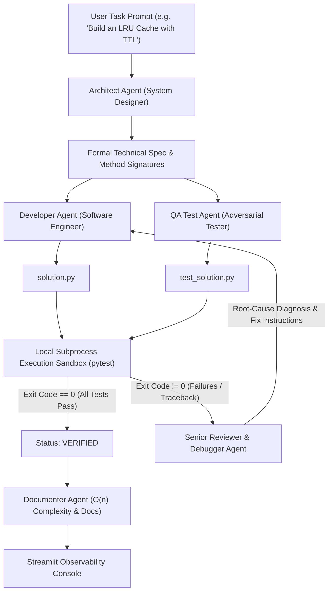

# PROJECT WORK-PLAN REPORT

## DevTeam AI: Autonomous Multi-Agent System for Collaborative Software Development, Peer Review, and Self-Healing Code Verification

**Specialization:** Agentic AI, Autonomous LLM Orchestration & Automated Software Engineering  
**Editable Word Document:** [Agentic_AI_WorkPlan_Report.docx](Agentic_AI_WorkPlan_Report.docx)  
**Project Duration:** 1 Month (4-Week Structured Implementation Plan)  

---

## 1. Problem Statement

Software engineering is an inherently collaborative, multi-stage discipline that extends far beyond the mechanical generation of syntax. High-reliability software demands rigorous architectural decomposition, boundary-testing for edge cases, critical peer review, and empirical runtime verification. While modern Large Language Models (LLMs) such as GPT-4, Claude 3.5, and Gemini 1.5 have shown impressive capabilities in generating isolated code snippets, **monolithic single-prompt LLMs fail to function as reliable software engineers** due to three fundamental limitations:

1. **Absence of Grounded Execution & Verification:** A single LLM cannot execute its own code. It frequently outputs syntactically plausible snippets that conceal subtle off-by-one errors, invalid imports, or type mismatches without ever discovering them.
2. **Lack of Adversarial Testing:** When the same LLM prompt writes both implementation and tests, it suffers from severe confirmation bias—authoring test cases that merely reflect its own assumptions rather than aggressively probing stress conditions and boundary states.
3. **Inability to Self-Heal:** When code execution throws a runtime exception or assertion failure, monolithic systems require a human engineer to manually copy tracebacks, diagnose root causes, and re-prompt the model in an inefficient, manual loop.

To address these challenges, this project introduces **DevTeam AI**, an autonomous multi-agent software engineering framework where specialized, goal-driven agents collaborate:
- An **Architect Agent** decomposes natural language requirements into formal specifications and interface definitions.
- A **Developer Agent** implements the functional logic adhering to the specification.
- A **QA Test Engineer Agent** designs an extensive adversarial unit test suite covering edge cases.
- An **Isolated Execution Sandbox** runs the tests locally via Python `subprocess` and captures execution tracebacks.
- A **Senior Reviewer / Debugger Agent** diagnoses failed assertions to drive an automated **closed-loop self-healing refactoring cycle** until 100% test passage is achieved.

---

## 2. Motivation: Why Agentic AI?

Agentic AI represents a transformative evolution in artificial intelligence, moving from passive conversational text generation to proactive, autonomous agents capable of planning, using local tools, observing runtime feedback, and collaborating across specialized roles:

- **Cognitive Division of Labor:** Complex engineering tasks are partitioned into distinct agent roles with dedicated system prompts, temperature parameters, and tool suites.
- **Peer Review & Inter-Agent Communication:** Agents communicate over a structured message bus, challenging assumptions, requesting revisions, and sharing test results.
- **Closed-Loop Self-Healing:** The system embodies true agency by reacting autonomously to environment feedback—modifying its own artifacts when compiler or Pytest assertions fail.
- **High Industry & CV Relevance:** The concepts demonstrated—state graphs, multi-agent orchestration, dynamic reflection, and tool-grounded execution—represent the bleeding edge of enterprise AI engineering.

---

## 3. Project Objectives

The overarching objective of DevTeam AI is to develop, evaluate, and deploy an autonomous multi-agent software development pipeline that accepts natural language specifications and autonomously produces verified, documented, production-ready Python modules with passing test suites within 60 seconds.

### Specific Engineering Objectives:
1. **Multi-Agent State-Graph Architecture:** Design a strongly typed blackboard state machine using **LangGraph** to manage task progression, message passing, and state persistence.
2. **Architectural Spec Decomposition:** Build an Architect Agent that extracts functional invariants, class hierarchies, and type-annotated method signatures.
3. **High-Quality Code Generation:** Build a Developer Agent that authors clean, PEP-8 compliant Python code implementing the technical specification.
4. **Adversarial Test Synthesis:** Build a QA Test Engineer Agent that independently authors extensive Pytest suites covering boundary conditions and stress tests.
5. **Local Subprocess Sandbox Engine:** Implement an execution harness using Python's `tempfile` and `subprocess` modules to execute test suites in isolated scratch directories with strict timeouts.
6. **Automated Self-Healing Cycle:** Implement a Reviewer/Debugger Agent that performs AST and traceback analysis on failed tests, feeding targeted guidance back to the Developer (capped at 3 iterations).
7. **Complexity Analysis & Technical Documentation:** Build a Documenter Agent that calculates Big-O time and space complexity and writes Sphinx/Google-style docstrings.
8. **Interactive Observability Console:** Deploy an interactive **Streamlit** dashboard visualizing live agent message flows, state graphs, and real-time execution terminals.

---

## 4. Multi-Agent System Architecture & Communication Protocol



### 4.1 Agent Roles & Tool Specifications

| Agent Name | Role & Mindset | Tools & Method | Primary Deliverable |
| :--- | :--- | :--- | :--- |
| **1. Architect Agent** | System Designer & Specifier | LLM Structured Output, Interface Decomposition | Formal Technical Spec (Classes, method signatures, invariants) |
| **2. Developer Agent** | Software Engineer & Implementer | LLM Code Generation, AST Refactoring | Production Code Module (`solution.py`) |
| **3. QA Test Agent** | Adversarial Test Engineer | Pytest Generator, Boundary-value probing | Comprehensive Test Suite (`test_solution.py`) |
| **4. Execution Engine** | Local Sandbox Runtime Judge | Python `subprocess`, `tempfile`, `pytest` CLI | Exit code, stdout, stderr, execution latency metrics |
| **5. Reviewer & Healer** | Senior Staff Debugger | Traceback Parser, Root-cause AST analysis | Targeted debugging instructions and patch guidance |
| **6. Documenter Agent** | Technical Writer & Profiler | Algorithmic Complexity Profiler, Docstring generator | Big-O Time/Space report and comprehensive README |

---

### 4.2 Centralized Typed State Schema (`DevTeamState`)

```python
from typing import TypedDict, List, Dict, Optional, Literal

class DevTeamState(TypedDict):
    user_prompt: str
    tech_spec: Optional[str]
    implementation_code: Optional[str]
    test_code: Optional[str]
    test_exit_code: Optional[int]
    test_stdout: Optional[str]
    test_stderr: Optional[str]
    tests_passed: int
    tests_failed: int
    retry_count: int
    debug_instructions: Optional[str]
    complexity_doc: Optional[str]
    agent_message_log: List[Dict[str, str]]
    status: Literal['DESIGNING', 'CODING', 'TESTING', 'EXECUTING', 'DEBUGGING', 'VERIFIED', 'FAILED']
```

---

## 5. End-to-End Inter-Agent Execution Workflow

1. **Phase 1: Ingestion & Architectural Decomposition (User $\rightarrow$ Architect)**  
   The user enters a task (e.g., *"Implement a Thread-Safe In-Memory LRU Cache with TTL Expiration"*). The Architect Agent decomposes this into an interface blueprint containing class definitions, method signatures, parameter types, and pre/post-conditions.
2. **Phase 2: Parallel Implementation & Adversarial Test Synthesis (Architect $\rightarrow$ Developer & QA)**  
   The state graph fans out:
   - The Developer Agent writes `solution.py`.
   - The QA Agent independently writes `test_solution.py` designed to probe edge cases (e.g., capacity 0, expired keys, concurrent reads/writes).
3. **Phase 3: Sandboxed Subprocess Execution (Developer & QA $\rightarrow$ Execution Sandbox)**  
   The Execution Sandbox copies both artifacts to an isolated temporary directory and executes `pytest -v`. It intercepts execution exit codes, assertion errors, and tracebacks without polluting the host environment.
4. **Phase 4: Decision Routing & Self-Healing Loop (Sandbox $\rightarrow$ Reviewer $\rightarrow$ Developer)**  
   - If all tests pass (exit code 0), execution advances to Phase 5.
   - If tests fail, the Reviewer Agent parses the stderr traceback, pinpoints the root cause, and generates surgical debugging advice. The Developer Agent revises the implementation, and the sandbox re-executes tests (supporting up to 3 automatic healing iterations).
5. **Phase 5: Documentation & Presentation (Documenter $\rightarrow$ Streamlit UI)**  
   The Documenter Agent analyzes the final verified code, determines asymptotic time and space complexity ($O(1)$ amortized, etc.), and formats the complete package for inspection in the Streamlit console.

---

## 6. Technical Feasibility & Software Stack

- **Orchestration Framework:** **LangGraph** (Python) for cyclic state-machine graphs, conditional edges, and state checkpointing.
- **LLM Engine:** Dual-mode flexibility supporting **Google Gemini 1.5 Flash** (via API for fast sub-second inference) or local **Ollama** (`Llama 3.1 8B` / `Qwen 2.5 Coder 7B`) for private, offline execution.
- **Execution & Sandboxing:** Python's standard `tempfile` and `subprocess` modules executing isolated Pytest runners with strict execution timeouts.
- **Observability & User Interface:** **Streamlit** web console featuring interactive agent message timelines, syntax-highlighted code viewers, and real-time terminal output.

---

## 7. 1-Month Implementation Schedule (4 Weeks)

| Timeline | Milestone Title | Core Engineering Objectives | Weekly Deliverable Output |
| :--- | :--- | :--- | :--- |
| **Week 1**<br>*(Days 1 – 7)* | **Requirements Analysis & Architecture Design** | Formalize problem statement; survey LangGraph and CrewAI patterns; design `DevTeamState` schema; setup project repository and base environment | System Architecture Blueprint & Typed State Schema |
| **Week 2**<br>*(Days 8 – 14)* | **Specialized Agent Engineering & Code Pipeline** | Implement Architect Agent (interface extraction); implement Developer Agent (code synthesis); implement QA Agent (adversarial Pytest generation); validate modular outputs | Architect, Developer, and QA Agent Modules |
| **Week 3**<br>*(Days 15 – 21)* | **Subprocess Sandbox & Self-Healing Feedback Loop** | Build `tempfile` execution runner with timeouts; connect Reviewer Agent to parse tracebacks; implement cyclic retry loop (Developer $\leftrightarrow$ QA $\leftrightarrow$ Reviewer); add loop termination safeguards | Closed-Loop Self-Healing Execution Engine |
| **Week 4**<br>*(Days 22 – 30)* | **Observability Dashboard, Benchmark & Final Report** | Build Streamlit dashboard (agent chat, code viewer, terminal logs); benchmark on 15 complex algorithmic challenges; measure Pass@1 and Pass@2 rates; compile final academic documentation | Complete Working System, Streamlit UI & Final Project Report |

---

## 8. Benchmark Evaluation & Verification Plan (15 Tasks)

In Week 4, the autonomous system will be evaluated across a diverse suite of 15 classic computer science and practical software engineering challenges:
1. **Thread-Safe In-Memory LRU Cache** with TTL Expiration
2. **Token Bucket Rate Limiter** with Burst Capacity & Concurrency
3. **Dijkstra's Shortest Path Algorithm** on Weighted Directed Graphs
4. **Thread-Safe Read-Write Locking Key-Value Store**
5. **Markdown to HTML AST Lexer and Parser**
6. **Self-Balancing AVL Binary Search Tree** with Rotations
7. **JWT (JSON Web Token) HMAC-SHA256 Signer and Expiry Validator**
8. **Concurrent Worker Thread Pool Task Queue** with Priority Scheduling
9. **Strassen's Divide-and-Conquer Matrix Multiplication**
10. **Trie (Prefix Tree)** with Levenshtein Distance Fuzzy Autocomplete
11. **Finite State Machine (FSM) Regex Matcher**
12. **Consistent Hashing Ring** with Virtual Nodes
13. **B-Tree Node Splitting and Insertion Algorithm**
14. **Event-Driven Observer Pub/Sub Message Broker**
15. **Sliding Window Maximum** using Monotonic Deque

### Target Empirical Metrics:
- **Pass@1 Rate:** $> 70\%$ of problems passing all unit tests on the initial generation.
- **Pass@2 (Self-Healed) Rate:** $> 90\%$ passing after at most one automated debugging cycle.
- **Mean Time to Resolve (MTTR):** Sub-45 seconds average completion time per task.

---

## 9. Academic & Career Value Proposition (CV / Resume Impact)

DevTeam AI is specifically selected and structured to deliver outstanding value on an academic CV and professional portfolio:
- **High Industry Relevance:** Multi-agent systems (Agentic AI) represent the top hiring and research priority across AI labs and tech enterprises.
- **Concrete Engineering Artifacts:** Unlike purely theoretical projects, this produces a running, demonstrable software system with live interactive visualizations.
- **Demonstrable Technical Depth:** Showcases mastery of state machines, inter-process communication, automated testing, compiler/traceback analysis, and asynchronous LLM orchestration.

---

## 10. Summary

**DevTeam AI** is the ideal project:
1. It looks academically rigorous, mature, and substantial to professors and reviewers with a **formal 1-month structured timeline**.
2. It stands out prominently on a **resume / CV** for Agentic AI, LLM orchestration, and automated software engineering.
3. Behind the scenes, its lightweight architecture (Python `subprocess` + `pytest` + `Streamlit`) allows you to **rapidly code, verify, and complete it in a few days to a week**.
